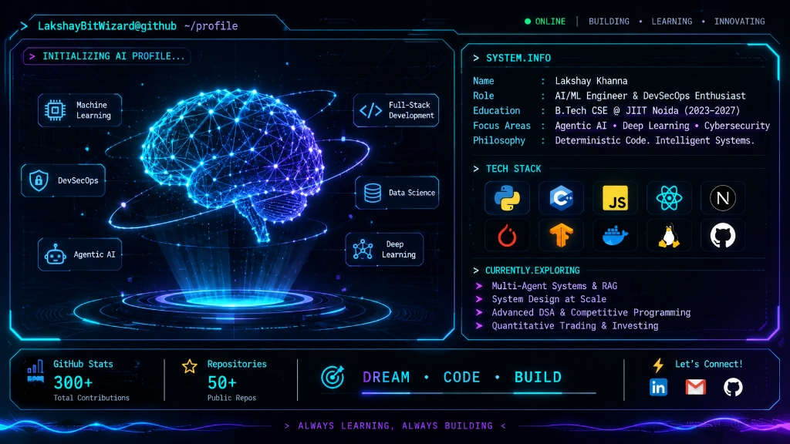

  <!-- AI Neural Command Center Hero Visual -->
  

    

  <!-- Dynamic Typing Live HUD Stream -->
  

    

  <!-- Quick Action & Social Badges -->
  &nbsp;
  &nbsp;
  

---

### :rocket: Featured Engineering Projects

<b>:shield: CodeGuardian AI - Autonomous Multi-Agent DevSecOps Platform</b>

 

> An enterprise-grade autonomous code review pipeline that intercepts GitHub PR webhooks, fires parallel specialist agents (Security, Quality, Documentation, Testing) via **LangGraph**, identifies vulnerabilities with **Semgrep**, and generates deterministic, syntax-perfect 1-click remediation PRs using **LibCST**.

- :zap: **Deterministic Remediation:** Zero syntax hallucinations using Python Concrete Syntax Trees (LibCST) instead of probabilistic LLM rewrites.
- :stopwatch: **~3.0s Pipeline Latency:** Sub-second LangGraph routing with Groq LPU inference delivering enterprise speed at $0/month BOM.
- :brain: **RAG Policy Grounding:** In-memory ChromaDB vector search (<120ms) ensuring strict compliance with organizational security standards.

 

 

`FastAPI` | `LangGraph` | `Next.js 14` | `Semgrep` | `LibCST` | `ChromaDB` | `Groq LPU`

 

<b>:brain: SecureNet AI - Deep Learning Network Intrusion Detection System</b>

 

> A full-stack, deep learning-powered NIDS pairing a custom 1D-ResNet trained on the NSL-KDD benchmark with a live packet-sniffing engine and an interactive React + TypeScript cybersecurity operations dashboard.

- :dart: **Deep Learning Classification:** 1D-ResNet with residual skip connections trained on 122-dim flow vectors to classify 5 threat classes (`DoS`, `Probe`, `R2L`, `U2R`, `Normal`).
- :satellite: **Live Packet Sniffing:** Native raw-socket packet capture via **Scapy** in 2s sliding windows with heuristic fallback and regex payload inspection.
- :bar_chart: **SecOps Dashboard:** Real-time dashboard in **React 18 + TypeScript + Tailwind** with model drift tracking and SHA-256 weight integrity verification.

 

 

`PyTorch` | `Scapy` | `Flask` | `React 18` | `TypeScript` | `Tailwind CSS`

 

<b>:chart_with_upwards_trend: Watchboard - Full-Stack Product Price & Dynamic Stock Tracker</b>

 

> A resilient, full-stack product price and stock monitoring platform that continuously monitors e-commerce storefronts, solves dynamic anti-bot hover traps, and logs every scrape outcome with sub-second accuracy.

- :robot: **Resilient Headless Scraper:** Automated browser pipeline via **Playwright** handling cookie consent, cursor movement, dwell-time anti-bot checks, and exponential backoff.
- :repeat: **Automated 2-Hour Scheduling:** External authenticated webhook cron sweeps preventing free-tier container sleep.
- :mag: **Full Audit Logging:** Per-scrape HTTP latency, response times, status codes, and stock trend graphs on **Supabase PostgreSQL**.

 

 

`Django 5` | `React.js` | `Playwright` | `PostgreSQL` | `Supabase` | `Vercel`

---

### :hammer_and_wrench: Tech Stack & System Capabilities

  <!-- Dynamic Neon Typing Tech Stream -->
  

 

#### :brain: Languages & Core Fundamentals

#### :robot: AI, Agents & Machine Learning

#### :globe_with_meridians: Full-Stack & Systems Architecture

#### :shield: DevSecOps, Cloud & Database

---

### :bar_chart: GitHub Activity & Analytics

  
  &nbsp;&nbsp;
  

 

<!-- Activity Graph -->

  

 

<!-- Contribution Snake Animation -->

  <picture>
    <source media="(prefers-color-scheme: dark)" srcset="https://raw.githubusercontent.com/LakshayBitWizard/LakshayBitWizard/output/github-contribution-grid-snake-dark.svg">
    <source media="(prefers-color-scheme: light)" srcset="https://raw.githubusercontent.com/LakshayBitWizard/LakshayBitWizard/output/github-contribution-grid-snake.svg">
    
  </picture>

---

  ⚡ AI Neural Command Center &bull; Designed & Engineered by <strong>Lakshay Khanna</strong> ⚡

